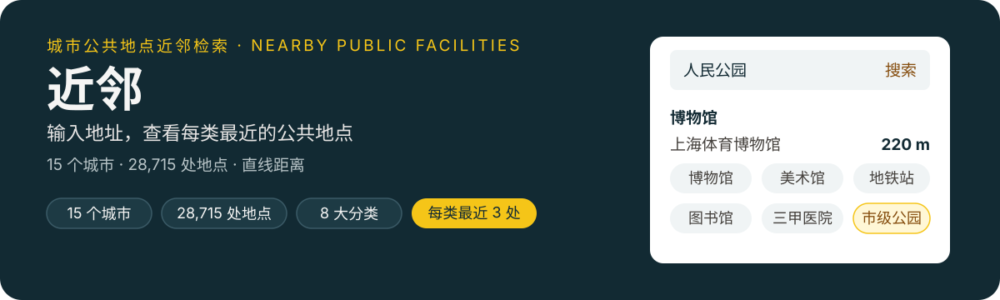
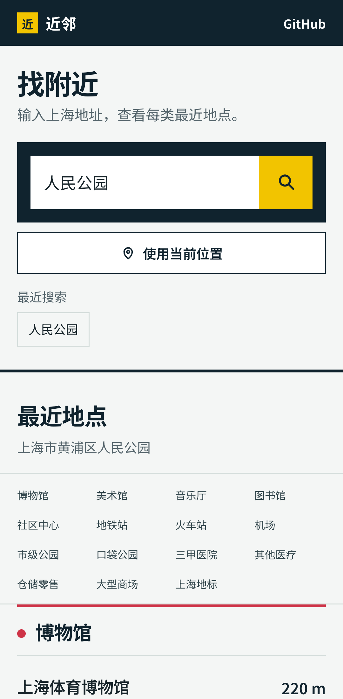

<p align="right"><a href="README.md">中文</a></p>

<p align="center">
  
</p>

<p align="center">
  <a href="https://city-public-facilities.xiaosang.cc/">▶ Try Online</a>
  ·
  <a href="https://github.com/holynova/city-public-facilities">GitHub Repository</a>
</p>

A nearby-search tool for public facilities across 15 Chinese cities: enter an address (or use your current location) and see the nearest places in 8 categories — education, transport, culture & arts, healthcare, parks & leisure, shopping, community services, and landmarks — with straight-line distances. 28,715 places; 3 nearest per category by default, expandable to 10.

## Screenshot

<p align="center">
  
</p>

## Cities Covered (15 cities, 28,715 places)

| City | Places | City | Places | City | Places |
|---|---|---|---|---|---|
| 上海 Shanghai | 2,790 | 北京 Beijing | 2,489 | 广州 Guangzhou | 2,356 |
| 成都 Chengdu | 2,281 | 重庆 Chongqing | 2,203 | 杭州 Hangzhou | 2,212 |
| 苏州 Suzhou | 2,131 | 南京 Nanjing | 2,094 | 西安 Xi'an | 2,024 |
| 武汉 Wuhan | 1,957 | 深圳 Shenzhen | 1,844 | 合肥 Hefei | 1,726 |
| 芜湖 Wuhu | 1,315 | 珠海 Zhuhai | 1,166 | 三河（燕郊） Sanhe (Yanjiao) | 127 |

## Categories (8 groups, 24 subcategories)

| Group | Subcategories | Count |
|---|---|---|
| 教育 Education | 幼儿园 kindergartens / 学校 schools / 大学 universities | 10,223 |
| 交通 Transport | 地铁站 metro stations / 火车站 railway stations / 机场 airports | 3,719 |
| 文化艺术 Culture & arts | 博物馆 museums / 美术馆 art museums / 音乐厅 concert halls | 3,186 |
| 公共服务 Public services | 政务服务中心 government service centers / 图书馆 libraries | 5,628 |
| 医疗健康 Healthcare | 三甲 tertiary-A / 二甲 secondary-A hospitals / 社区卫生机构 community health centers | 3,186 |
| 环境休闲 Parks & leisure | 市级公园 city parks / 社区公园 community parks | 992 |
| 商业购物 Shopping | 大型商场 large malls / 仓储零售 warehouse retail | 1,695 |
| 城市地标 Landmarks | 城市地标 city landmarks | 86 |

## How to Use

1. Pick a city, type an address (e.g. 人民公园 / People's Park) or tap "使用当前位置" (Use current location).
2. Once the address resolves, the nearest places are shown grouped by the 8 categories.
3. Each category shows the 3 nearest by default, expandable to 10; results can be exported as currently expanded.

## Data Notes

- The site shows manually updated snapshots of public-facility data; the Sanhe (Yanjiao) directory is compiled from OpenStreetMap data and converted to GCJ-02, while other cities use public directories and Amap POI data.
- Distances are straight-line, computed on GCJ-02 coordinates — not walking or driving routes.
- Results are for first-pass trip planning only; for opening hours, hospital grades, school types, and service coverage, check the responsible authority or the venue's official channels.
- Details: [Data Methods & Scope](https://city-public-facilities.xiaosang.cc/about.html#data-method) (in Chinese).

## Run Locally

```bash
npm install
npm run build        # TypeScript compile
npm run web          # start the local server
npm test             # vitest tests
```

Data collection needs an Amap Open Platform web-service key (set `AMAP_WEB_KEY` in `.env`, never commit it to Git); browsing the site needs no key — `docs/` already holds the full data snapshot.

## Tech

- TypeScript + Node (collection CLI) + a zero-framework static frontend (`docs/`).
- Data pipeline: Amap POI / metro lines / official culture directories / Health Commission hospital review announcements → normalize → coordinate matching → per-city JSON export.
- Hospital grades come from traceable Shanghai Health Commission announcements, not a live registry.

```
src/amap/           Amap collection: facilities, metro lines, universities, culture & hospital enrichment
src/sources/        Official directory normalization (culture, medical institution imports)
src/export/         Per-city JSON directory export
src/web/            Local server and facility index
src/cli.ts          Collection / export CLI entry
docs/               Static site: index.html + app.js + data/<city>.json
```
