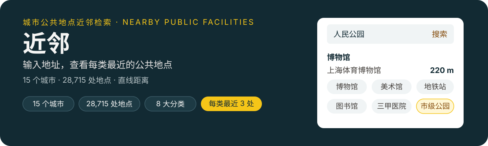
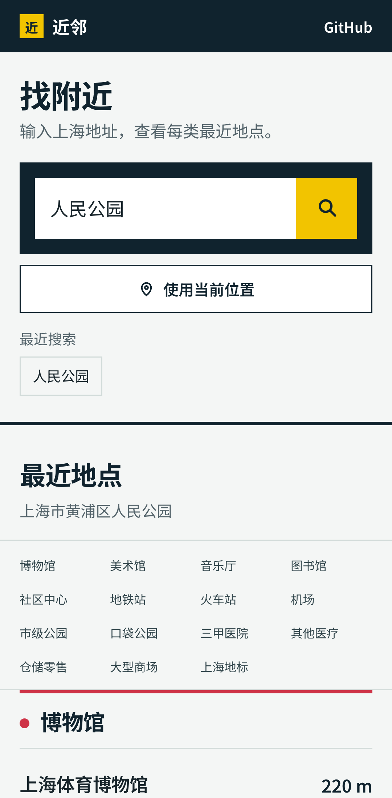

<p align="right"><a href="README.en.md">English</a></p>

<p align="center">
  
</p>

<p align="center">
  <a href="https://city-public-facilities.xiaosang.cc/">▶ 在线使用</a>
  ·
  <a href="https://github.com/holynova/city-public-facilities">GitHub 仓库</a>
</p>

城市公共地点近邻检索：输入地址或使用当前位置，按教育、交通、文化艺术、医疗健康、环境休闲、商业购物、公共服务和城市地标 8 大分类，展示每类最近的地点与直线距离。覆盖 15 个城市、28,715 处公共地点，每类默认显示最近 3 处，可展开至最多 10 处。

## 截图

<p align="center">
  
</p>

## 覆盖城市（15 个，共 28,715 处）

| 城市 | 地点数 | 城市 | 地点数 | 城市 | 地点数 |
|---|---|---|---|---|---|
| 上海 | 2,790 | 北京 | 2,489 | 广州 | 2,356 |
| 成都 | 2,281 | 重庆 | 2,203 | 杭州 | 2,212 |
| 苏州 | 2,131 | 南京 | 2,094 | 西安 | 2,024 |
| 武汉 | 1,957 | 深圳 | 1,844 | 合肥 | 1,726 |
| 芜湖 | 1,315 | 珠海 | 1,166 | 三河（燕郊） | 127 |

## 分类（8 大类、24 个细类）

| 大类 | 细类 | 数量 |
|---|---|---|
| 教育 | 幼儿园 / 学校 / 大学 | 10,223 |
| 交通 | 地铁站 / 火车站 / 机场 | 3,719 |
| 文化艺术 | 博物馆 / 美术馆 / 音乐厅 | 3,186 |
| 公共服务 | 政务服务中心 / 图书馆 | 5,628 |
| 医疗健康 | 三甲 / 二甲医院 / 社区卫生机构 | 3,186 |
| 环境休闲 | 市级公园 / 社区公园 | 992 |
| 商业购物 | 大型商场 / 仓储零售 | 1,695 |
| 城市地标 | 城市地标 | 86 |

## 使用方法

1. 选择城市，输入地址（如"人民公园"）或点"使用当前位置"。
2. 地址解析后，在全部城市目录中按 8 大分类分组展示最近地点。
3. 每类默认显示最近 3 处，可展开至最多 10 处；支持按当前展开状态导出结果。

## 数据说明

- 网站展示按需人工更新的公共设施数据快照；三河（燕郊）目录基于 OpenStreetMap 公开地图数据整理并转换为 GCJ-02，其他城市沿用公开目录与高德地图地点数据。
- 距离基于 GCJ-02 坐标计算，为两点间直线距离，不代表实际步行或驾车路线。
- 查询结果仅供出行初步筛选；场所开放状态、医院等级、学校属性和服务范围等信息，请以主管部门或场所官方渠道为准。
- 详细说明见站内 [数据方法与使用边界](https://city-public-facilities.xiaosang.cc/about.html#data-method)。

## 本地运行

```bash
npm install
npm run build        # TypeScript 编译
npm run web          # 启动本地服务
npm test             # vitest 测试
```

数据采集需要高德开放平台 Web 服务 Key（`.env` 中配置 `AMAP_WEB_KEY`，不要提交到 Git）；仅浏览网站不需要 Key，`docs/` 下已有完整数据快照。

## 技术

- TypeScript + Node（采集 CLI）+ 纯静态前端（`docs/`，零框架）。
- 数据管线：高德 POI / 地铁线路 / 官方文化名录 / 卫健委医院评审公告 → 规范化 → 坐标匹配 → 按城市导出 JSON。
- 医院三甲 / 二甲来自上海卫健委公开评审公告快照（可追溯，不等同于实时全市注册表）。

```
src/amap/           高德采集：设施、地铁线路、大学、文化与医院富化
src/sources/        官方名录规范化（文化、医疗机构导入）
src/export/         按城市导出 JSON 目录
src/web/            本地服务与设施索引
src/cli.ts          采集 / 导出命令行入口
docs/               静态网站：index.html + app.js + data/<城市>.json
```
